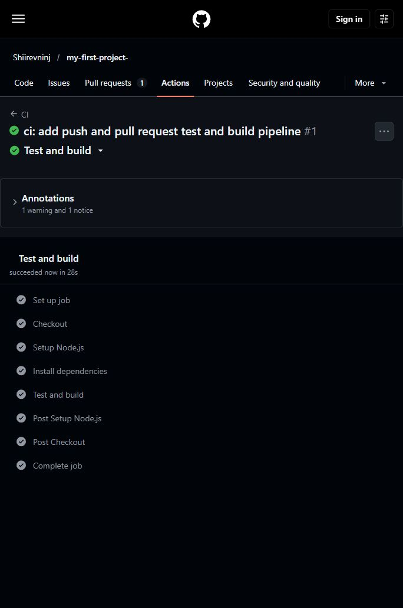
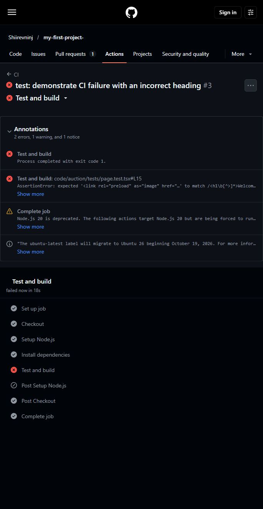

# 7-р лабораторийн ажил: GitHub Actions ашиглан CI Pipeline байгуулах

Огноо: 2026-10-20 · Холбогдох CLO: CLO4

## Хүлээлгэн өгөх материал

- [Репозиторийн холбоос](https://github.com/Shiirevninj/my-first-project-)
- [Хэрэгжүүлсэн салбар](https://github.com/Shiirevninj/my-first-project-/tree/ci/github-actions-lab7): `ci/github-actions-lab7`
- [Pull Request #4](https://github.com/Shiirevninj/my-first-project-/pull/4)
- [Амжилттай ажиллуулалтын screenshot](screenshots/ci-success.jpg)
- [Амжилтгүй ажиллуулалтын screenshot](screenshots/ci-failure.jpg)

## Хэрэгжүүлэлт

Репозиторийн `code/auction` хавтас дахь Next.js төсөлд Vitest ашигласан 5 тест нэмсэн. Нүүр хуудасны үндсэн агуулга, гарчиг, зургийн тайлбар, баримт бичгийн холбоос болон шинэ цонхонд нээгдэх холбоосын тохиргоог шалгана. Эдгээр нь сервер дээр үүсгэсэн HTML үр дүнг шалгах тестүүд юм.

Workflow файл: [`.github/workflows/ci.yml`](../../.github/workflows/ci.yml). `push` болон `pull_request` үйл явдал бүрд Ubuntu орчинд дараах 4 алхам ажиллана.

| Алхам | Үйлдэл |
| --- | --- |
| Checkout | `actions/checkout@v4` ашиглан кодыг татна. |
| Setup Node.js | `actions/setup-node@v4` ашиглан Node.js 24 тохируулна. |
| Install dependencies | `code/auction` хавтаст `npm ci` ажиллуулна. |
| Test and build | `npm test`, дараа нь `npm run build` ажиллуулна. |

`npm ci` нь `package-lock.json` файлд тогтоосон хувилбаруудыг суулгана. `npm test` нь `vitest run` командыг ажиллуулж, тест дуусмагц гарна. Тест амжилтгүй бол build эхлэхээс өмнө тухайн алхам зогсоно. GitHub-ийн автоматаар нэмдэг бэлтгэл болон цэвэрлэгээний алхмууд энэ 4 алхмын тоонд орохгүй.

## Амжилттай үр дүн

`f1139fe` commit дээр бүх 5 тест тэнцэж, Next.js production build амжилттай дууссан. Checkout, Setup Node.js, Install dependencies, Test and build алхмууд бүгд амжилттай болсон.

- [Push ажиллуулалт — success](https://github.com/Shiirevninj/my-first-project-/actions/runs/39357004716)
- [Pull Request ажиллуулалт — success](https://github.com/Shiirevninj/my-first-project-/actions/runs/39357020441)
- [Бүрэн лог](logs/ci-success.log), [ажиллуулалтын мэдээлэл](logs/ci-success.json)



## Санаатайгаар унагасан үр дүн

`1597f73` commit дээр `code/auction/tests/page.test.tsx` файлын гарчиг шалгах нэг тестийн хүлээгдэж буй утгыг зориудаар буруу болгосон.

```tsx
// Зөв хүлээлт:
expect(html).toMatch(/<h1\b[^>]*>To get started, edit the /);

// Санаатайгаар оруулсан буруу хүлээлт:
expect(html).toMatch(/<h1\b[^>]*>Welcome to the auction/);
```

Нүүр хуудасны бодит гарчиг `To get started, edit the ...` хэвээр байсан тул `renders the getting started heading` тест `AssertionError` алдаатай дууссан. Нийт 5 тестээс 4 нь тэнцэж, 1 нь унасан. `npm test` нь exit code 1 буцааснаар Test and build алхам болон CI ажиллуулалт амжилтгүй болсон. Энэ үед `npm run build` ажиллаагүй.

- [Push ажиллуулалт — failure](https://github.com/Shiirevninj/my-first-project-/actions/runs/39357133951)
- [Pull Request ажиллуулалт — failure](https://github.com/Shiirevninj/my-first-project-/actions/runs/39357137835)
- [Бүрэн лог](logs/ci-failure.log), [ажиллуулалтын мэдээлэл](logs/ci-failure.json)

Screenshot дээр буруу тестийн мөр болон `Process completed with exit code 1` гэсэн мэдээлэл харагдана. GitHub дээр Actions → тухайн ажиллуулалт → Test and build хэсгээс дэлгэрэнгүй логийг уншиж болно.



## Засвар ба дахин шалгалт

`2320e1f` commit дээр тестийн зөв хүлээлтийг буцаасан. Дахин ажиллуулахад бүх 5 тест болон production build амжилттай болсон. Амжилтгүй ажиллуулалтын түүх, screenshot болон лог нотолгоо болж хадгалагдсан.

- [Засварын дараах push ажиллуулалт](https://github.com/Shiirevninj/my-first-project-/actions/runs/39357264122)
- [Засварын дараах Pull Request ажиллуулалт](https://github.com/Shiirevninj/my-first-project-/actions/runs/39357269318)

## Өөрийн компьютерт ажиллуулах

Node.js 24 ашиглан репозиторийн үндсэн хавтаснаас:

```bash
cd code/auction
npm ci
npm test
npm run build
```

## Богино тайлбар

GitHub Actions ашиглан push болон Pull Request бүрд кодыг татах, орчин тохируулах, хамаарал суулгах, тест болон build ажиллуулах CI pipeline байгуулсан. Эхний ажиллуулалтад бүх 5 тест тэнцсэн. Дараа нь нэг тестийн хүлээгдэж буй гарчгийг зориудаар буруу болгож, CI алдааг илрүүлэн зогсож байгааг баталгаажуулсан. Тестийн зөв утгыг буцаасны дараа CI дахин амжилттай болсон.

## Ашигласан баримт бичиг

- [GitHub: setup-node v4](https://github.com/actions/setup-node/blob/v4/README.md)
- [GitHub: checkout v4](https://github.com/actions/checkout/blob/v4/README.md)
- [Vitest: Getting Started](https://vitest.dev/guide/)
- [React: renderToStaticMarkup](https://react.dev/reference/react-dom/server/renderToStaticMarkup)
